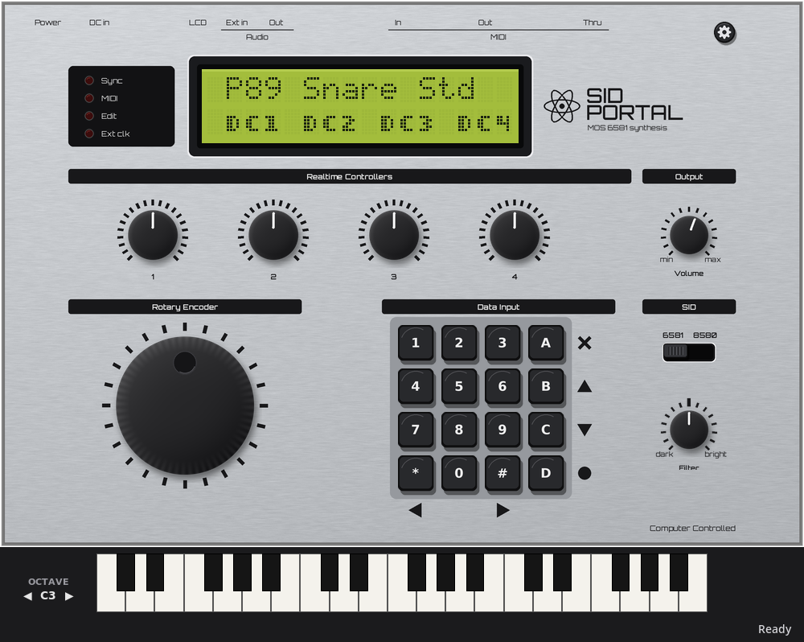
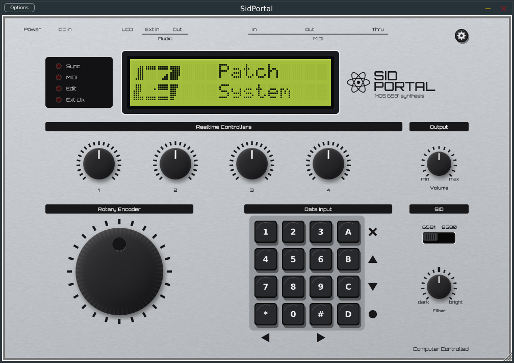

# SidPortal



SidPortal emulates the Elektron SidStation, a MOS 6581 synthesizer module from 1999. It runs the SidStation's original OS r34 firmware on an emulated 68HC11 and produces sound with reSIDfp or reSID. Linux, macOS and Windows use the same JUCE standalone app and VST3 instrument. Linux also builds a command-line ALSA host for realtime playback and scripted WAV rendering.

**Firmware is not included.** On first launch, choose your own dump of the SidStation OS r34 firmware (either the 128 KB EPROM dump or the 32 KB program). The app validates the image and copies it into the per-user data directory. The command-line host accepts an explicit firmware path with `--rom`.

**Disclaimer:** SidPortal is an independent project. It is not affiliated with, endorsed by or sponsored by Elektron. Elektron and SidStation are trademarks of their respective owners, and are used here only to say which hardware SidPortal emulates.

## Requirements

The Linux standalone and VST3 need a C++20 compiler, CMake 3.20 or newer, JUCE 8, and the X11, FreeType and Fontconfig development libraries. The optional command-line realtime host also needs ALSA development headers. Packages include `base-devel cmake alsa-lib` on Arch, or `build-essential cmake libasound2-dev libfreetype-dev libfontconfig1-dev libx11-dev` on Debian or Ubuntu.

The macOS VST3 and standalone app need Xcode command-line tools, CMake 3.20 or newer, and JUCE 8. The public macOS release is a universal binary for Apple silicon and Intel Macs and has a macOS 11 minimum deployment target. The Windows VST3 and standalone app need Visual Studio 2022, CMake 3.20 or newer, and JUCE 8.

## Build and run

```sh
git clone --depth 1 --branch 8.0.16-security https://github.com/juce-framework/JUCE.git ../JUCE
cmake -S . -B build -DCMAKE_BUILD_TYPE=Release -DJUCE_DIR=../JUCE
cmake --build build -j
build/SidPortalPlugin_artefacts/Release/Standalone/SidPortal
```

The standalone includes the SID panel, keyboard strip, and host noise-gate controls. On Linux, `tools/install_desktop.sh build/SidPortalPlugin_artefacts/Release/Standalone/SidPortal` adds this JUCE app to the desktop menu. The same build also produces the optional command-line host for ALSA realtime playback and scripted WAV renders.

The standalone stores its battery-backed RAM under the platform's per-user data directory. Linux uses `$XDG_DATA_HOME/sidportal` (default `~/.local/share/sidportal`), macOS uses `~/Library/Application Support/SidPortal`, and Windows uses `%APPDATA%\SidPortal`.

A fresh unit has no patches, just as the hardware does after a memory reset. The JUCE standalone starts from the factory bank when a matching `.syx` file is available in the source checkout's `patches/` directory. **Load SysEx…** in the gear menu sends another bank. An all-patch bank replaces every patch in memory.

The Linux desktop installer writes `~/.local/share/applications/sidportal.desktop` pointing at the JUCE standalone executable and installs the icon from `tools/assets/icons`.

## VST3 plugin

The build produces a VST3 at `build/SidPortalPlugin_artefacts/Release/VST3/SidPortal.vst3` and the matching JUCE standalone. On Linux, copy the VST3 to `~/.vst3`; the macOS install path is below. Both hosts use the same emulated board and artwork. On Debian or Ubuntu, JUCE also needs `libfreetype-dev libfontconfig1-dev libx11-dev libxcomposite-dev libxcursor-dev libxext-dev libxinerama-dev libxrandr-dev libxrender-dev`.

On macOS, the VST3 is under `build-macos/SidPortalPlugin_artefacts/Release/VST3/` and the standalone app is under `build-macos/SidPortalPlugin_artefacts/Release/Standalone/`. The standalone can be copied to Applications. Install the VST3 in `~/Library/Audio/Plug-Ins/VST3/`. Prebuilt universal macOS packages are attached to tagged releases in the public repository. These release builds are unsigned; on first launch, macOS may require Control-clicking the standalone app in Finder and choosing **Open**.

## Build artifacts

GitHub Actions builds Linux x86_64, Windows x64 and universal macOS packages on pull requests, pushes to `main`, version tags and manual dispatches. Each run uploads a ZIP and SHA-256 file. Version-tag builds attach the platform ZIPs and checksums to the GitHub release. The Linux package includes the JUCE standalone, VST3 and command-line realtime/WAV renderer; the Windows package includes the JUCE standalone and VST3. SidStation firmware is never included.

Test the actual artifacts from a completed GitHub Actions run with `tools/sandbox/run.sh linux RUN_ID` or `tools/sandbox/run.sh windows RUN_ID`. The script downloads the platform ZIP and its VST3 host check from that run, then extracts and runs them in a Docker runtime image; the containers do not build SidPortal. It requires Docker and an authenticated GitHub CLI (`gh`). Results are written under `.sandbox-out/ci-run-RUN_ID/`.

The Linux sandbox uses Xvfb and an ALSA null sink. It checks that the packaged standalone opens its first-launch firmware picker. If the test data directory has your own `roms/firmware.bin`, it also runs the VST3 host audio test and checks for non-silent output; otherwise it checks VST3 loading and callback processing without firmware. Pass a different test data directory as the optional third argument. Firmware and presets are mounted read-only and are never included in the CI package. The Windows sandbox runs the Windows CI standalone and VST3 under Wine and checks the picker, window creation and plugin processing; it does not replace a native Windows DAW test.



- **Firmware:** the plugin loads it at runtime from `$SIDPORTAL_ROM`, the platform's per-user data directory, or this project's `roms/`. It is never built into the plugin or standalone app. If none is found, the app prompts you to select an image and copies it to the per-user data directory for future instances: Linux `$XDG_DATA_HOME/sidportal/firmware.bin` (default `~/.local/share/sidportal/firmware.bin`), macOS `~/Library/Application Support/SidPortal/firmware.bin`, and Windows `%APPDATA%\SidPortal\firmware.bin`.
- **Memory:** each plugin instance keeps its own battery-backed RAM in the project. A new instance starts from a copy of the JUCE standalone's memory, or from a cleared unit that receives the factory bank. Projects never write back to the standalone's memory. Booting is emulated faster than realtime, so an instance is ready about two seconds after it loads.
- **Parameters:** the four knobs, Volume, Filter character, the SID chip, Noise gate and its threshold, so the host can automate them and MIDI-learn controllers onto them.
- **Gear menu:** Load SysEx…, enter or exit ASID mode, open **Noise Gate…**, and choose the SID emulation engine.
- **MIDI:** MIDI from the host goes to the firmware at its sample position, including ASID SysEx when the firmware is in ASID mode. The firmware's MIDI out, which carries SysEx dumps and the knobs' CCs, comes back to the host.
- **Ext In:** an optional stereo input bus named "Ext In", off by default. Enable it in the host and its audio goes into the SID's external input.

### Build on macOS

From the SidPortal checkout, build against JUCE 8.0.16-security (the version used for the public release packages):

```sh
git clone --depth 1 --branch 8.0.16-security https://github.com/juce-framework/JUCE.git ../JUCE
cmake -S . -B build-macos -DCMAKE_BUILD_TYPE=Release -DJUCE_DIR=../JUCE \
  -DSIDPORTAL_CLI=OFF -DCMAKE_OSX_ARCHITECTURES="arm64;x86_64" \
  -DCMAKE_OSX_DEPLOYMENT_TARGET=11.0
cmake --build build-macos --config Release --parallel
```

The `SidPortalPlugin` target produces both formats. The source tree does not include the SidStation firmware; if no firmware is found at launch, SidPortal prompts you to select it and copies it to `~/Library/Application Support/SidPortal/firmware.bin`. You can also set `SIDPORTAL_ROM` in the environment used to launch the app or DAW.

When `roms/firmware.bin` is present, `ctest` also runs two plugin checks. The first, `sidportal_vst3_hostcheck`, loads the built bundle the way a DAW does. The second, `sidportal_plugin_smoke`, does the following:
- boots a cleared instance;
- plays a note;
- switches engines and chips;
- saves the state and restores it into a second instance;
- feeds the Ext In bus;
- changes the sample rate.

## Look

The panel's printing is set in Orbitron, the nearest open font to the hardware's wide, rounded-square lettering. The keypad keys keep a plain sans, like the hardware's. The artwork is bundled in `tools/assets/panel`, so neither the panel nor the build needs any image libraries. The knob pointers, LEDs and encoder dimple are images too, because Tk's own canvas lines and circles have no antialiasing. Each knob size has a sprite sheet with one frame per position. The plugin uses a set at twice the panel size, so it stays sharp when the plugin window is enlarged.


## Playing it

- **Keypad:** A is EXIT, B is UP, C is DOWN, D is ENTER, `*` is LEFT and `#` is RIGHT. The digits select menu items.
- **ASID mode:** choose **Enter ASID Mode** in the gear menu (or press DOWN twice and ENTER). It receives SID register updates over MIDI SysEx. Route an external ASID MIDI stream into the standalone's selected MIDI input or the VST3 from its host. Stop that MIDI source, then choose **Exit ASID Mode / Restart** to return to firmware operation.
- **Realtime knobs:** drag vertically, hold Shift for fine control, or use the mouse wheel. They map to the values on screen from left to right. In patch play they are the patch's direct controllers DC1–DC4, which the firmware also sends and receives as **CC 16–19**, so set a hardware controller to those CCs to use it in their place.
- **Encoder:** drag around it or use the mouse wheel.
- **Computer keyboard:**
  - `0`–`9` are the digit keys.
  - The arrow keys are UP/DOWN/LEFT/RIGHT.
  - Return is ENTER; BackSpace or Escape is EXIT.
  - `-` and `=` turn the encoder.
  - Hold `A` `S` `D` `F` and tap `-` or `=` to turn knobs 1–4.
- **Keyboard strip:** the strip below the panel plays notes on MIDI channel 1.

The right-hand column of the panel holds controls the unit never had:

- **Output > Volume** sets the output level.
- **SID** is a slide switch: it picks the 6581 (the original chip) or the 8580. The logo's subtitle follows it.
- **Filter** sets the chip character.

**SID emulation** in the gear menu picks the engine:

- **reSIDfp** (the default) comes from libresidfp, the engine in sidplayfp. It models the filters of both chips in more detail, including the 6581's distortion, and has per-chip filter curves.
- **reSID** is Dag Lem's original engine.

Switching engines takes effect live, without rebooting the machine: the new engine picks up the current SID registers, so held notes keep sounding. Switching chips or engines fades the sound out and back in over about a third of a second, because changing chips steps the output's DC level, which would otherwise come through as a loud thump. The emulated machine boots for about 12 seconds before the top menu appears, just like the unit. The output stays muted until the firmware has initialised the SID, which skips the thump the real unit makes at power-on. MIDI sent during boot is ignored. On the real unit, a note sent at that point leaves a half-received message, and the firmware then restarts itself as soon as the next status byte arrives.

**Ext In** works like the jack on the unit: audio from an enabled host input bus goes into the SID's external input, which the firmware routes through the filter. The filter type, cutoff, resonance and filter envelope all shape it, and note-ons and CCs can trigger the envelope. From the command line, use `--ext-in DEV --ext-gain F`, or the headless `extin FILE.wav` command.

The **Filter** knob, marked dark and bright, sets the chip character. Real SID filters differ from chip to chip: the same cutoff setting sounds darker on some units and brighter on others. Double-clicking the knob returns it to the centre. How it works depends on the engine:

- **reSIDfp:** it moves the filter curve of either chip from one end of its range to the other.
- **reSID:** it shifts the 6581's cutoff DAC voltage (the filter bias) between −0.5 and +0.5 V. It has no effect on the 8580 under reSID, so the knob is hidden then. You can assign it a MIDI CC under **Setup… > Filter character CC**: type a number, or press **Learn** and move a control. The CC works on any channel, maps 0–127 across the range, and is not passed on to the firmware. From the command line, use `--filter-bias V` (−0.5 to +0.5), `--bias-cc N`, `--engine resid|residfp`, or the `filterbias V`, `model 6581|8580` and `engine NAME` commands.

A faint 16 Hz buzz at idle is authentic. The 6581's oscillators leak through even with their envelopes closed, as the manual describes. In **About noise**, the Elektron manual also describes bus noise and recommends a noise gate for best results.

**Host noise gate** is optional and defaults **off**, including in existing sessions. It acts on the SID's final audio output after emulation; it does not change the firmware's oscillator **Gate** envelope setting or SID registers. In the JUCE standalone, choose **gear > Noise Gate…** to adjust **Host noise gate** and **Threshold**; these controls are also automatable and saved with VST3 sessions. The threshold runs from **−90 to −18 dBFS** (default −60 dBFS); lower values let quieter notes and release tails through, while higher values suppress more idle sound. Opening, closing, a short hold and hysteresis are smoothed to reduce chatter and clicks. For Linux realtime playback or scripted WAV rendering, use `--noise-gate --gate-threshold-db -60`; realtime stdin also accepts `noisegate 0|1` and `gatethreshold DB`. The gate may still trim quiet tails if its threshold is set above them.

## Command line

```sh
build/sidportal --rom roms/firmware.bin --realtime --audio default
build/sidportal --rom roms/firmware.bin --fresh --script "wait 12000;syx patches/Presets.syx;press enter;wait 500;lcd"
build/sidportal --rom roms/firmware.bin --nvram ram.bin --render out.wav --script "wait 12000;press enter;wait 500;press enter;note 57 100 800"
build/sidportal --help
```

Headless scripts are `;`-separated commands:

- `wait MS`
- `lcd`
- `press KEY` (also `down KEY` and `up KEY`)
- `enc N`
- `knob I V`
- `midi HEX..`
- `note N VEL MS`
- `syx FILE`
- `leds`
- `filterbias V`, `model 6581|8580` and `engine resid|residfp`
- `save`

Run `ctest --test-dir build --output-on-failure` for the tests. The firmware test needs the ROM, and its SysEx checks also need the factory bank in `patches/`.

## How it works

The emulated board is a 68HC11 with a 2 MHz E clock and the following memory and I/O map:

| Address | Device |
| --- | --- |
| `$0000–$7FFF` | 32 KB battery-backed RAM |
| `$8000–$FFFF` | Firmware |
| `$1040` | SID, clocked at 1 MHz |
| `$1060` / `$1061` | HD44780 LCD (instruction / data) |
| `$1080` | Keypad encoder latch |

The rest of the panel and MIDI go through the HC11's on-chip peripherals:

- **Knobs:** the HC11 A/D converter.
- **Rotary encoder:** pulses input capture 1 (up) or 2 (down).
- **MIDI:** the SCI at 31250 baud.
- **LEDs:** port A.

The firmware's update engine runs from output compare 2. Every SID write is applied at its own CPU cycle, because the instrument's character comes from those 50–200 Hz register updates. `src/core` holds the CPU, the LCD and the board. `src/main.cpp` is the Linux command-line host for headless scripting, WAV rendering and ALSA realtime playback. `plugin/` provides the shared JUCE panel used by the standalone app and VST3 on all platforms.

## Status

The emulator boots, menus and editing work, it receives and sends SysEx, it plays from MIDI, ASID register streaming works, and the LEDs work. One part is not emulated:

- the flash-upgrade mode.

It has not been compared against a recording of real hardware, so the sound is the emulation engine's model of the chip, not a measured match for any particular unit.

## License

GPL-3.0-or-later; see [LICENSE](LICENSE). Vendored code keeps its own license; see [THIRD_PARTY.md](THIRD_PARTY.md).
